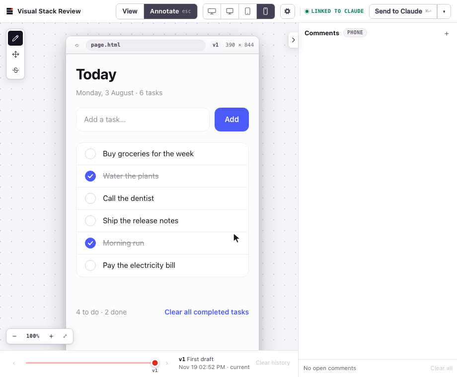
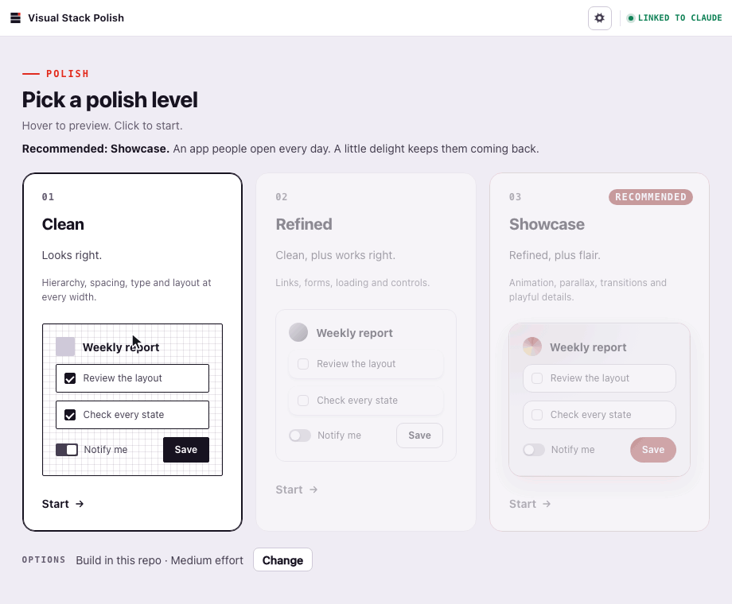

# Visual Stack

[](https://github.com/Cavalry-Collective/visual-stack/actions/workflows/ci.yml)
[](https://github.com/Cavalry-Collective/visual-stack/actions/workflows/security.yml)
[](https://scorecard.dev/viewer/?uri=github.com/Cavalry-Collective/visual-stack)
[](LICENSE)

<!-- Hidden until each one reports green again.
     Sonar has not analysed the repository since v5.0.0: the quality gate is
     not computed and the security rating is still the E it was left on.

[](https://sonarcloud.io/summary/new_code?id=Cavalry-Collective_visual-stack)
[](https://sonarcloud.io/summary/new_code?id=Cavalry-Collective_visual-stack)
-->


## It’s easier to show than explain.

Visual Stack is a collection of tools to help you review, polish, and build with your agent, right on the screen.

[](#review)

## Review

Review works with new wireframes and running apps, at desktop, tablet and phone sizes.



[Read about Review →](docs/review.md)

## Polish

Polish audits your UI and shows what could be improved, with before-and-after screenshots for each proposed fix.



[Read about Polish →](docs/polish.md)

## Get started

Both tools come in one plugin.

### Claude Code

Install in Claude Code:

```text
/plugin marketplace add Cavalry-Collective/visual-stack
/plugin install vstack@cavalry-collective
```

Then run Review:

```text
/vstack:review Wireframe a desktop personal task manager with minimal aesthetics.
```

Or run Polish:

```text
/vstack:polish Audit the checkout page on localhost:3000.
```

### Codex<sup>1</sup>

Install in your terminal:

```text
codex plugin marketplace add Cavalry-Collective/visual-stack
codex plugin add vstack@cavalry-collective
```

Then run Review:

```text
$vstack:review Wireframe a desktop personal task manager with minimal aesthetics.
```

Or run Polish:

```text
$vstack:polish Audit the checkout page on localhost:3000.
```

<sup>1</sup> Codex support is experimental. Codex has no background monitor that keeps a two-way link open, so Visual Stack has the agent check in at short intervals. Occasionally the agent stops checking too early. If that happens, ask it to resume watching.

## Requirements

- A current version of Claude Code or Codex
- A supported Node.js LTS release
- Git
- A local web browser
- At least one strong opinion about border radius

## Security

Installing this plugin runs its code on your machine, so every change to `main` passes a set of scans before it lands: static analysis, a secret scan over the whole history, a workflow audit, and a code-quality gate. The badges above report the last run. [SECURITY.md](SECURITY.md) says what each gate enforces and how to report a vulnerability.

## Contribute

Visual Stack is open source and under active development. Expect rough edges, breaking changes, and occasional moments of character development.

- [Report an idea or bug](https://github.com/Cavalry-Collective/visual-stack/issues)
- [Read the contribution guide](CONTRIBUTING.md)
- [Report a security issue](SECURITY.md)

---

Built by [DeyangChan](https://github.com/DeyangChan), presumably after one too many rounds of screenshot-based feedback. Released by [Cavalry Collective](https://cavalry.sg).

Licensed under the [MIT License](LICENSE).
