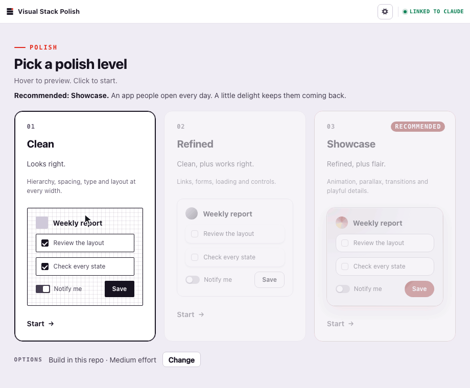

# Visual Stack Polish

[← Back to Visual Stack](../README.md)

## A design audit, with before-and-after previews.

Polish audits your UI, identifies what could be improved, and shows each proposed fix with before-and-after screenshots.

Give your agent a screen to review. It checks the layout, interactions, and visual consistency, then presents its findings. You can approve, steer, or reject each fix. Nothing in your code changes without your approval.

## Run it

| Host | Command |
|---|---|
| Claude Code | `/vstack:polish Audit the checkout page on localhost:3000.` |
| Codex | `$vstack:polish Audit the checkout page on localhost:3000.` |

The older `/vstack:design-review` command still works. Codex support is experimental. See [Get started](../README.md#get-started) for details.

### What it works on

- **Your own app.** Provide its address, and your agent implements the fixes you approve.
- **Any website.** Choose *Report only* to turn approved fixes into a shareable report. On sites you don't own, your agent never submits forms, makes payments, or sends messages.

## What you can do

### Choose how deep the audit goes

| Level | What your agent does |
|---|---|
| **Clean** | Finds visual issues. Opens every menu, tab, and form step, then checks hierarchy, spacing, alignment, typography, colour, components, and copy at eight screen sizes, from an iPhone SE to a 1920px desktop. |
| **Refined** | Everything in Clean, plus interaction issues. Clicks every link and button, submits each form empty and with invalid values, simulates a slow network, and tests Back and refresh. Checks validation, loading, control states, and jarring transitions. |
| **Showcase** | Everything in Refined, plus the finishing touches that make a site stand out. Adds animations, parallax effects, smooth transitions, scroll interactions, and playful details that bring the design to life. |

## Why Polish?

Ask a coding agent to make a screen look better, and you might get vague feedback like "the spacing feels inconsistent". Or an overconfident redesign nobody asked for.

Polish shows you each proposed fix in a before-and-after screenshot, so you can judge the result for yourself.

---

See also [Review](review.md), a Figma-like feedback layer for AI coding agents.
