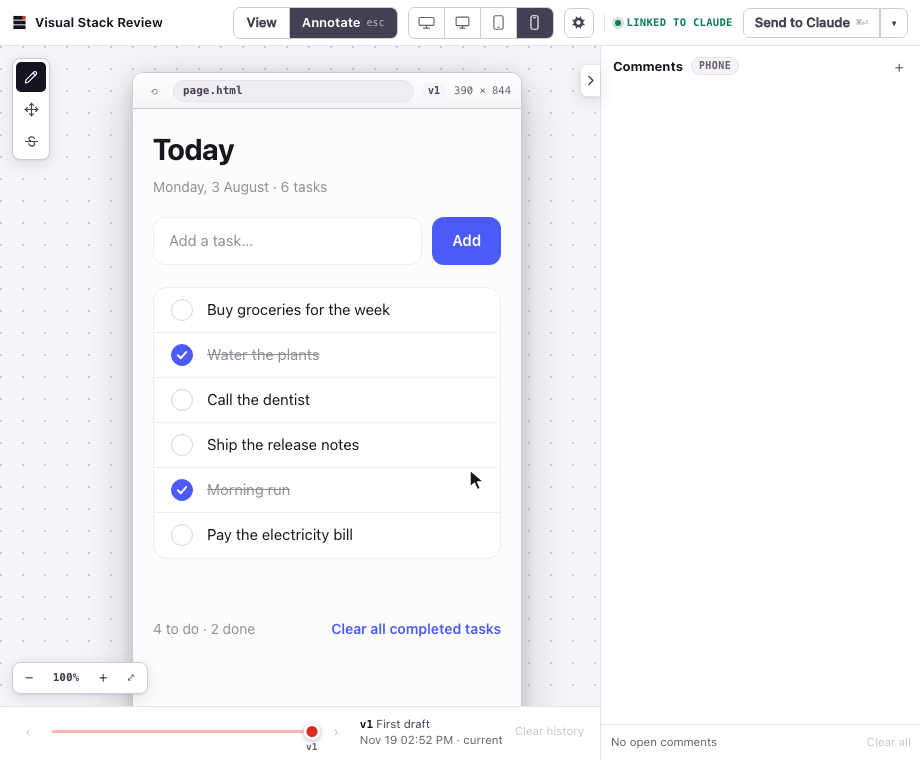

# Visual Stack Review

[← Back to Visual Stack](../README.md)

## Stop prompting. Start pointing.

Review adds a Figma-like feedback layer to AI coding agents.

Create a new screen, or open an existing app. Click anywhere and leave highly professional feedback such as:

> "claude its 3am just align the buttons"
>
> "why is everything a card. who hurt you"
>
> "pls undo the series b dashboard energy we have 4 users"
>
> "the padding is now between you and god"

Your agent applies the feedback and updates the design in the same place, hopefully without adding another gradient.

*Point. Comment. Iterate. No more jumping between chat and the UI.*

## Run it

| Host | Command |
|---|---|
| Claude Code | `/vstack:review Wireframe a desktop personal task manager with minimal aesthetics.` |
| Codex | `$vstack:review Wireframe a desktop personal task manager with minimal aesthetics.` |

The older `/vstack:wireframe` still works. Codex support is experimental. See [Get started](../README.md#get-started) for what to expect.

### What to point it at

- **A new wireframe.** Describe the screen, and your agent builds it and opens it for comments.
- **A running app.** Give its address, as in `/vstack:review Open localhost:3000 for review.` Your agent applies each comment to the source code.
- **A public website.** Give its URL. The code isn't yours, so each comment becomes a note about the design.

## Why Review?

Design feedback is spatial. Chat is linear. Humans are tired.

As feedback becomes more visual, chat becomes the bottleneck. Context gets buried in long conversations. Screenshots go stale. Describing which element you mean becomes a small detective novel.

Review keeps every comment attached to the element, route, and version it refers to. Your agent receives the feedback with the visual context intact.

No scrolling back through the chat. No screenshot graveyard on your desktop. No describing what you could just point at.

## Technical Details

### Live Link

Each workspace is linked to one agent session. The link holds while that session is active and its heartbeat is less than 15 seconds old. Comments wait in one FIFO, and only the active comment is in the agent's hands.

### Review Lifecycle

### On your machine

The review server runs on your machine and binds to `127.0.0.1` only. For a running app or a website, it proxies the app so the workspace and the app share an origin. That shared origin lets a comment attach to an element rather than to a coordinate.

If the app asks for a sign-in, you sign in yourself in the workspace window. Your agent never enters credentials.

## Where things live

Each review is saved under `.vstack/local/review/` in your project. Reviews saved when the tool was called Wireframe stay readable under `.vstack/local/wireframe/`. Add `**/.vstack/local/` to your `.gitignore` to keep reviews out of your commits.

---

See also [Polish](polish.md), a design audit with before-and-after screenshots.
